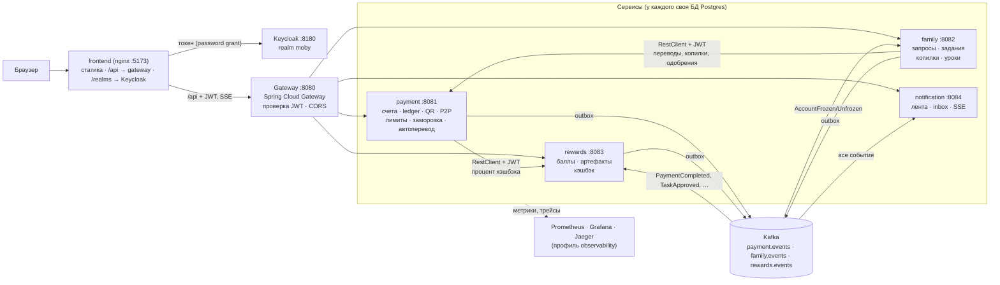
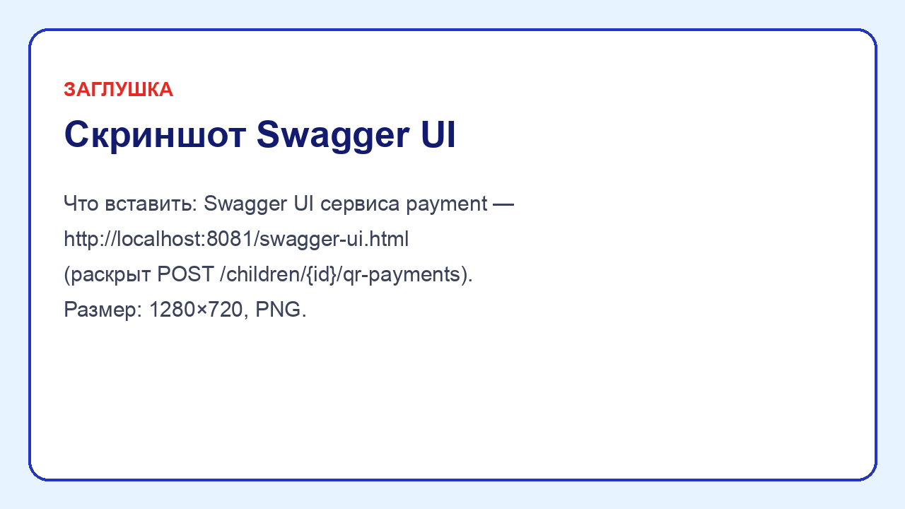
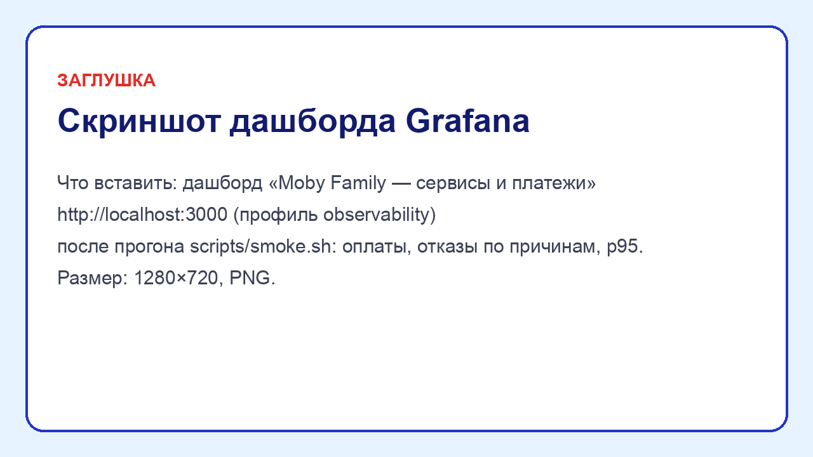
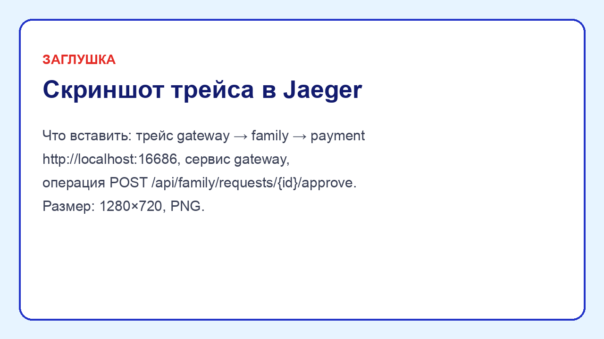
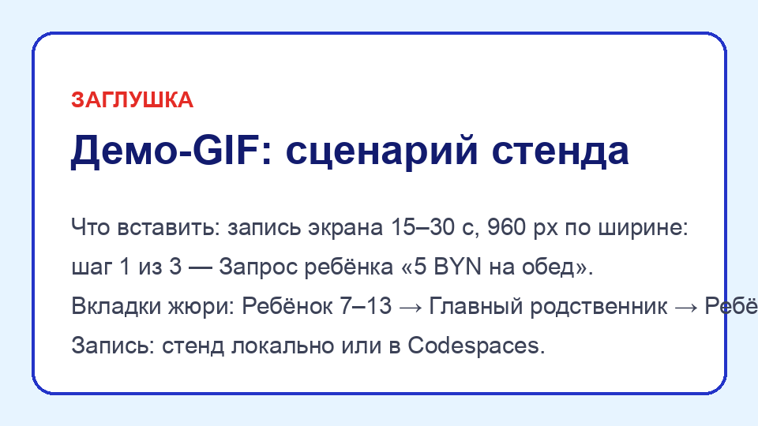

# Moby Family — детско-семейный банкинг (МТБанк / Moby)

Moby Family — семейный банкинг внутри Moby: родитель видит счета детей, ставит лимиты по категориям и
периодам, одобряет запросы «5 BYN на обед» и переводы сверх лимита; ребёнок 7–13 платит по QR и копит, подросток
14–17 переводит деньги и управляет подписками, а за полезные действия оба получают баллы и артефакты с кэшбэком.
Хакатонный прототип, где вся логика жила в браузере, переписан в бэкенд на **Java 21 / Spring Boot 4**: четыре
доменных сервиса со своими БД, gateway, Keycloak, Kafka с transactional outbox и наблюдаемость. Фронтенд прототипа
сохранён один в один, а его прежняя логика стала исполняемой спецификацией: у каждого из 25 сценариев есть
JUnit-аналог ([таблица](docs/PROGRESS.md#соответствие-сценариев-frontendspecstoretestjs-и-junit)).

[](https://mike010111.github.io/Moby-family/)
[](https://codespaces.new/Mike010111/Moby-family?quickstart=1)

* **Демо на GitHub Pages** — офлайн-режим: тот же интерфейс, логика прототипа выполняется в браузере, без бэкенда.
* **Open in GitHub Codespaces** — настоящий стенд целиком (≈ 3–5 минут на старт): фронтенд откроется сам,
  Swagger, Keycloak, Grafana и Jaeger — на вкладке *Ports*. Нужна машина 4 ядра / 16 ГБ — она выбирается
  автоматически.

## Архитектура



| Сервис | Ответственность |
|---|---|
| **payment** | счета, ledger, QR-оплата, P2P, лимиты, категории, хард-блоки, заморозка, подписки, автоперевод, деньги копилок |
| **family** | семья и роли, запросы с одобрением, задания, копилки (7–13 через одобрение, 14–17 сразу), уроки, GPS |
| **rewards** | баллы, магазин артефактов, кэшбэк-предложения, продление |
| **notification** | лента родителя и inbox ребёнка, доставка по SSE |
| **gateway** | единая точка входа: JWT, маршрутизация, CORS, health для фронтенда |
| **libs/common** | только контракты: события Kafka, `ErrorCode`, `Money` |

Внутри сервиса — модули Spring Modulith (`ApplicationModules.verify()`), слои controller → service → repository
(ArchUnit), DTO отдельно от сущностей (MapStruct), схема — только Flyway.

## Ключевые инженерные решения

* **Ledger.** `Money` — BigDecimal со scale 2; каждая операция — транзакция двойной записи, сумма проводок = 0,
  баланс счёта сверяется с проводками. → [ADR-007](docs/adr/0007-money-ledger-concurrency.md)
* **Блокировки.** Проверка лимита и списание — в одной транзакции под `SELECT … FOR UPDATE` в фиксированном
  порядке счетов; тест: 50 параллельных оплат не пробивают ни лимит, ни баланс. → [ADR-007](docs/adr/0007-money-ledger-concurrency.md)
* **Идемпотентность.** `Idempotency-Key` для пополнений, оплат, переводов и копилок: уникальный индекс, повтор
  возвращает сохранённый ответ (в том числе отказ), тот же ключ с другим телом — `IDEMPOTENCY_MISMATCH`.
* **Outbox.** События — только через transactional outbox (Spring Modulith Event Publication Registry → Kafka),
  повторная отправка под ShedLock, консьюмеры идемпотентны (`processed_events`). → [ADR-002](docs/adr/0002-transactional-outbox.md)
* **Безопасность.** Keycloak, claims `member_id` / `family_id` / `roles`; JWT проверяют gateway и каждый сервис;
  родитель — только дети своей семьи, ребёнок — только своё; тесты на 403 в каждом сервисе. → [ADR-005](docs/adr/0005-security-keycloak-jwt.md)
* **Время и ошибки.** Время — только через внедрённый `Clock` (Europe/Minsk); ошибки — RFC 9457 ProblemDetail с
  кодами прототипа (`LIMIT`, `FROZEN`, `HARD_BLOCK`, …).

Остальные ADR: [001 разбивка на сервисы](docs/adr/0001-service-decomposition.md) ·
[003 синхронные вызовы](docs/adr/0003-synchronous-calls.md) · [004 уведомления и SSE](docs/adr/0004-notifications-sse.md) ·
[006 слой данных фронтенда](docs/adr/0006-frontend-data-layer.md) · [008 наблюдаемость](docs/adr/0008-observability.md) ·
[009 сборка на Maven](docs/adr/0009-maven.md) · [010 витрина](docs/adr/0010-showcase.md).
Решения по неоднозначностям — [DECISIONS](docs/DECISIONS.md), план и модель данных — [PLAN](docs/PLAN.md).

## Стек

Java 21 · Spring Boot 4.1 (Web MVC, Validation, Data JPA, Security / OAuth2 Resource Server, Actuator) ·
Spring Cloud Gateway · Spring Modulith · Maven · PostgreSQL 17 + Flyway · Kafka 4 · Keycloak 26 · MapStruct ·
springdoc-openapi · ShedLock · Micrometer + Prometheus + Grafana · OpenTelemetry + Jaeger ·
JUnit 5, AssertJ, Testcontainers, ArchUnit, JaCoCo · Playwright · Docker Compose · GitHub Actions (CI, Pages, GHCR) ·
фронтенд — ванильный JS (ES-модули) без сборки.

## Как это выглядит

| Swagger UI | Grafana |
|---|---|
|  |  |
| **Jaeger** | **Демо** |
|  |  |

## Запуск локально

Нужен Docker (≈ 4 ГБ памяти для контейнеров). Одна команда:

```bash
docker compose up -d --build --wait     # первая сборка образов — несколько минут
```

Без `--build` compose возьмёт готовые образы из GitHub Container Registry (а каких нет — соберёт).

| Что | Адрес | Доступ |
|---|---|---|
| Фронтенд (стенд для жюри) | http://localhost:5173 | вкладки = вход под демо-пользователями |
| API Gateway | http://localhost:8080/api/… | Bearer JWT |
| Swagger UI | http://localhost:8081/swagger-ui.html (payment), :8082 family, :8083 rewards, :8084 notification | |
| Keycloak | http://localhost:8180 | admin / admin, realm `moby` |

Демо-пользователи (пароль у всех `demo`): **anna** — Анна, главный родственник; **misha** — Миша, 9 лет;
**ivan** — Иван, 17 лет; **olga** — родитель другой семьи (для проверки 403).
«Сбросить демо» на стенде возвращает seed-данные во всех сервисах.

Наблюдаемость — отдельный профиль, включается одной командой:

```bash
COMPOSE_PROFILES=observability TRACING_EXPORT_ENABLED=true docker compose up -d --wait
```

Grafana — http://localhost:3000 (дашборд «Moby Family — сервисы и платежи»), Prometheus — http://localhost:9090,
Jaeger — http://localhost:16686.

Сквозная проверка и остановка:

```bash
scripts/smoke.sh                                    # ключевые сценарии через gateway
docker compose --profile observability down         # остановить (данные Postgres — в volume)
docker compose --profile observability down -v      # остановить и удалить данные
```

Известные ограничения стенда — в [PROGRESS](docs/PROGRESS.md#известные-ограничения).

## Тесты

```bash
./mvnw clean verify                 # 117 тестов: unit + интеграционные (Testcontainers: Postgres, Kafka),
                                    # ArchUnit, Modulith verify, JaCoCo ≥ 80 % строк — нужны JDK 21 и Docker
cd frontend && npm test             # 25 сценариев прототипа (исполняемая спецификация)
cd frontend && npm run test:e2e     # Playwright: офлайн-демо как на GitHub Pages (npx playwright install chromium)
```

[](https://github.com/Mike010111/Moby-family/actions/workflows/ci.yml)
[](https://github.com/Mike010111/Moby-family/actions/workflows/pages.yml)
[](https://github.com/Mike010111/Moby-family/actions/workflows/images.yml)
