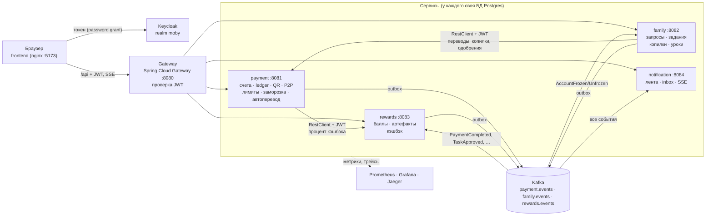

# Moby Family — бэкенд детско-семейного банкинга (МТБанк / Moby)

Хакатонный прототип на чистом JS (бизнес-логика жила в браузере) переписан в бэкенд на **Java 21 / Spring Boot 4**:
четыре доменных сервиса со своими БД, gateway, Keycloak, Kafka с transactional outbox, наблюдаемость.
Фронтенд прототипа сохранён один в один — заменён только слой данных.

Поведение задано исполняемой спецификацией прототипа (`frontend/spec`): у каждого из 25 сценариев есть
JUnit-аналог — таблица в [docs/PROGRESS.md](docs/PROGRESS.md).

## Быстрый старт

Нужен Docker (≈ 4 ГБ свободной памяти для контейнеров).

```bash
docker compose up -d --build --wait   # первая сборка образов — несколько минут (Maven внутри Docker)
scripts/smoke.sh                      # сквозная проверка ключевых сценариев через gateway
```

| Что | Адрес | Доступ |
|---|---|---|
| Фронтенд (стенд с панелью жюри) | http://localhost:5173 | вкладки = вход под демо-пользователями |
| API Gateway | http://localhost:8080/api/… | Bearer JWT |
| Keycloak | http://localhost:8180 | admin / admin, realm `moby` |
| Grafana | http://localhost:3000 | дашборд «Moby Family — сервисы и платежи» |
| Prometheus | http://localhost:9090 | |
| Jaeger | http://localhost:16686 | трейсы всех сервисов |

Демо-пользователи (пароль у всех `demo`): **anna** — Анна, главный родственник; **misha** — Миша, 9 лет;
**ivan** — Иван, 17 лет; **olga** — родитель другой семьи (для проверки 403).
«Сбросить демо» на стенде возвращает seed-данные во всех сервисах (`POST /api/<service>/demo/reset`, профиль `demo`).

Сборка и тесты (нужны JDK 21 и Docker для Testcontainers):

```bash
./mvnw clean verify                   # unit + интеграционные тесты (Postgres, Kafka), ArchUnit, Modulith, JaCoCo ≥ 80 %
cd frontend && npm test               # сценарии прототипа (спецификация)
```

## Архитектура



| Сервис | Ответственность | Ключевое |
|---|---|---|
| **payment** | счета, ledger, QR-оплата, P2P, лимиты, категории, хард-блоки, заморозка, подписки, автоперевод, деньги копилок | двойная запись, `SELECT … FOR UPDATE`, Idempotency-Key, порядок проверок `checkPayment`, котировка P2P SEND/APPROVED/REQUEST/BLOCKED, ShedLock |
| **family** | семья и роли, дети и когорты, запросы с одобрением, задания, копилки (7–13 через одобрение, 14–17 сразу), уроки, GPS | машины состояний, деньги только через API payment, проекция заморозки |
| **rewards** | баллы, магазин артефактов, кэшбэк-предложения, продление | баллы по событиям, идемпотентные консьюмеры |
| **notification** | лента родителя и inbox ребёнка | тексты из прототипа, SSE `notification` / `changed` |
| **gateway** | единая точка входа | JWT (Keycloak), маршрутизация, SSE без таймаута |
| **libs/common** | только контракты | события Kafka, `ErrorCode`, `Money`, `BusinessException` |

Внутри каждого сервиса — модули Spring Modulith (`ApplicationModules.verify()`), слои controller → service →
repository (ArchUnit), DTO отдельно от сущностей (MapStruct), схема — только Flyway.

### Главные технические решения

* **Деньги.** `Money` — BigDecimal scale 2; ledger двойной записи; баланс сверяется с проводками; проверка лимита и
  списание — в одной транзакции под `SELECT … FOR UPDATE`; тест на 50 параллельных оплат. → [ADR-007](docs/adr/0007-money-ledger-concurrency.md)
* **Идемпотентность.** `Idempotency-Key` для пополнений, оплат, переводов и копилок; уникальный индекс; повтор
  возвращает сохранённый ответ (в том числе отказ оплаты).
* **Время.** Только через внедрённый `Clock` (Europe/Minsk); календарные периоды лимитов — порт `unitStart`,
  `limitPeriod`, `periodTitle`. ArchUnit запрещает `Instant.now()` без часов.
* **Ошибки.** RFC 9457 ProblemDetail с полем `code` (коды прототипа: `LIMIT`, `FROZEN`, `HARD_BLOCK`, … `AGE`).
* **События.** Только через transactional outbox (Spring Modulith → Kafka), консьюмеры идемпотентны
  (`processed_events`). → [ADR-002](docs/adr/0002-transactional-outbox.md)
* **Безопасность.** Keycloak; claims `member_id`, `family_id`, `roles`; JWT проверяют gateway и каждый сервис;
  родитель — только дети своей семьи, ребёнок — только своё. → [ADR-005](docs/adr/0005-security-keycloak-jwt.md)

## API (через gateway)

| Префикс | Примеры |
|---|---|
| `/api/payment` | `GET /children/{id}/account`, `GET /children/{id}/operations`, `POST /children/{id}/qr-payments`*, `POST /children/{id}/topups`*, `GET /children/{id}/p2p/quote?amount=`, `POST /children/{id}/p2p-transfers`*, `PUT /children/{id}/frozen`, `PUT /children/{id}/categories/{key}`, `POST|PUT|DELETE /children/{id}/limits`, `PUT /children/{id}/autopay`, `PATCH|DELETE /children/{id}/subscriptions/{sid}` |
| `/api/family` | `GET /me`, `GET|POST /requests`, `POST /requests/p2p-over`, `POST /requests/{id}/approve|decline`, `POST /children/{id}/tasks[/{tid}/submit|approve]`, `POST /children/{id}/piggies`, `POST /children/{id}/piggies/{pid}/deposits`*, `PUT …/target`, `DELETE …`, `POST /children/{id}/lessons/complete` |
| `/api/rewards` | `GET /me/points`, `GET /children/{id}`, `POST /children/{id}/artifacts/{aid}/purchase`, `POST /children/{id}/artifacts/renew` |
| `/api/notifications` | `GET /feed`, `GET /inbox?childId=`, `POST /inbox/seen`, `GET /stream` (SSE) |

`*` — обязателен заголовок `Idempotency-Key`. OpenAPI каждого сервиса — `/v3/api-docs` (springdoc) на его порту.

## Структура репозитория

```
frontend/          прототип (экраны без изменений) + js/core/api-store.js; spec/ — исполняемая спецификация
services/
  gateway/         Spring Cloud Gateway (WebFlux)
  payment/         счета, ledger, оплаты, лимиты, …
  family/          семья, запросы, задания, копилки, уроки
  rewards/         баллы, артефакты, кэшбэк
  notification/    лента, inbox, SSE
libs/common/       контракты событий, коды ошибок, Money
pom.xml            родительский POM: версии, BOM, плагины (Maven, ADR-009)
infra/             docker-compose, Dockerfile-ы, realm Keycloak, Prometheus, Grafana, nginx
scripts/smoke.sh   сквозная проверка через gateway
docs/              PLAN, PROGRESS (с таблицей соответствия тестов), DECISIONS, adr/
```

## Документация

* [docs/PLAN.md](docs/PLAN.md) — модули, модель данных, REST, события, распределение правил прототипа
* [docs/DECISIONS.md](docs/DECISIONS.md) — решения по неоднозначностям
* [docs/PROGRESS.md](docs/PROGRESS.md) — что сделано, соответствие сценариев прототипа JUnit-тестам, ограничения
* ADR: [001 разбивка на сервисы](docs/adr/0001-service-decomposition.md) ·
  [002 outbox](docs/adr/0002-transactional-outbox.md) ·
  [003 синхронные вызовы](docs/adr/0003-synchronous-calls.md) ·
  [004 уведомления и SSE](docs/adr/0004-notifications-sse.md) ·
  [005 безопасность](docs/adr/0005-security-keycloak-jwt.md) ·
  [006 слой данных фронтенда](docs/adr/0006-frontend-data-layer.md) ·
  [007 деньги и конкурентность](docs/adr/0007-money-ledger-concurrency.md) ·
  [008 наблюдаемость](docs/adr/0008-observability.md) ·
  [009 сборка на Maven](docs/adr/0009-maven.md)

## Известные ограничения

* Стенд демонстрационный: Keycloak в режиме `start-dev`, вход через password grant, HTTP без TLS.
* SSE-подписки живут в памяти инстанса notification (масштабирование — в ADR-004).
* Цикл недель магазина артефактов, как и в прототипе, не моделируется: текущая неделя — «вещи в руках».
* Трейс HTTP-запроса и трейс доставки его события через outbox — разные трейсы (ADR-008).
